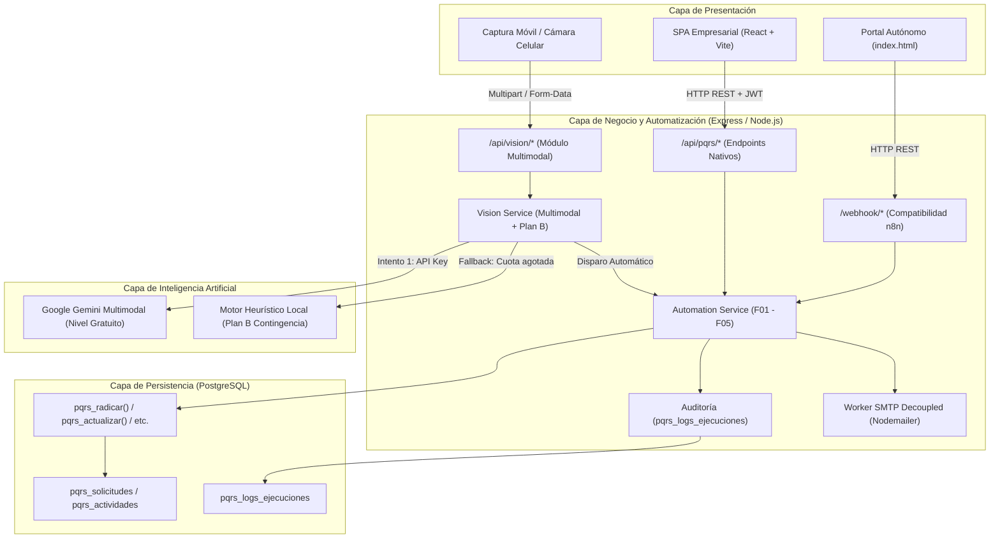
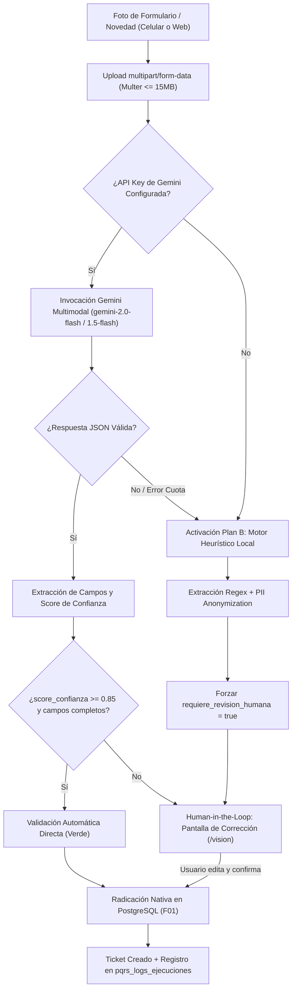

# Documento Técnico de Arquitectura e Implementación – Tercer Corte
**Asignatura:** Desarrollo de Aplicaciones Empresariales  
**Programa:** Tecnología en Desarrollo de Sistemas Informáticos – Unidades Tecnológicas de Santander (UTS)  
**Docente:** Wilson Castaño Galviz  
**Fecha:** Octubre 31, 2026  
**Proyecto:** DocuMind & PQRS B2B – Motor Propio de Automatización e IA Multimodal de Visión  
**Versión:** 3.0.0 (Tercer Corte)

---

## 1. Presentación y Resumen Ejecutivo

El presente documento consolida la entrega final del **Tercer Corte** de la asignatura *Desarrollo de Aplicaciones Empresariales*. En esta fase se cumplieron dos objetivos estructurales del sistema:
1. **Desacoplamiento total de n8n en la nube (Componente 1 - Ruta A):** La lógica de orquestación, reglas de negocio, SLAs dinámicos, control de idempotencia y notificaciones transaccionales fue re-implementada como servicios nativos en Node.js/Express y PostgreSQL, eliminando cualquier dependencia de planes de pago o servicios externos caídos.
2. **Incorporación de Visión por Computador e IA Multimodal (Componente 2):** Se construyó un módulo de procesamiento visual para la lectura y digitalización de formularios físicos diligenciados en papel y fotografías de novedades de campo tomadas con cámaras de teléfonos inteligentes, incorporando un mecanismo **Human-in-the-Loop** basado en umbrales de confianza (`score_confianza < 0.85`), extracción estructurada en JSON y un **Plan B de contingencia heurística local** ante cortes de cuota o caídas de red.
3. **Calidad, Seguridad y Cumplimiento Normativo:** Protección estricta de datos personales según la **Ley 1581 de 2012** de Colombia, control de acceso basado en roles (**RBAC**), gestión segura de secretos mediante variables de entorno, y validación empírica mediante un dataset de 20 casos reales fotografiados con celular.

---

## 2. Arquitectura General del Sistema

La arquitectura de la solución sigue el patrón de **Arquitectura en Capas desacoplada con fallback resiliente**, conectando el frontend web (React + Vite y portal HTML ligero) con una API REST en Express y almacenamiento transaccional en PostgreSQL:

---

## 3. Componente 1: Motor Propio de Automatización en Código (Ruta A)

### 3.1. Justificación de la Ruta A vs. Ruta B
Se seleccionó la **Ruta A (Código Propio en Express/Node.js)** por los siguientes motivos técnicos y arquitectónicos:
- **Reducción de huella operativa:** Se evita levantar y mantener un contenedor Docker adicional de n8n autoalojado, reduciendo el consumo de RAM en ~800 MB y simplificando el despliegue en entornos gratuitos (Render, Railway, Fly.io).
- **Consistencia transaccional:** Toda la lógica de idempotencia, actualización de versiones (`concurrency tokens`) y asignación de agentes se ejecuta en el mismo ciclo de vida de la aplicación Express y en transacciones ACID de PostgreSQL.
- **Transparencia y compatibilidad:** Se implementaron rutas espejo bajo `/webhook/*` que replican exactamente los contratos de entrada/salida que utilizaba n8n, permitiendo que tanto el portal `index.html` histórico como la nueva SPA en React funcionen sin cambios estructurales.

### 3.2. Inventario de Flujos Migrados

| Flujo | Método / Ruta Nativa | Ruta Espejo n8n | Responsabilidad y Lógica Ejecutada |
|---|---|---|---|
| **F01** | `POST /api/pqrs/radicar` | `POST /webhook/radicar-pqrs` | Validación sintáctica, clasificación de área, cálculo de SLA dinámico, invocación a `pqrs_radicar(p JSONB)` en PostgreSQL, disparo desacoplado de email de confirmación y escalamiento si es urgente. Idempotencia por `request_id`. |
| **F02** | `GET /api/pqrs/consultar` | `GET /webhook/consultar-pqrs` | Consulta de solicitudes para agentes con Basic Auth / Bearer JWT, KPIs de gestión, cálculo de cumplimiento de SLA y límite de 100 registros con paginación. |
| **F03** | `GET /api/pqrs/:id/tracking` | `GET /webhook/consultar-ticket` | Consulta pública protegida por doble factor: Radicado (`PQRS-YYYY-NNNNNN`) + `tracking_token` (UUIDv4). Retorna detalle del caso y actividades públicas sin exponer datos sensibles. |
| **F04** | `POST /api/pqrs/:id/actualizar` | `POST /webhook/actualizar-ticket` | Gestión del ciclo de vida del ticket por agentes. Bloqueo pesimista en SQL, control de concurrencia optimista (`version`), registro de actividad y actualización de estado. |
| **F05** | `POST /api/pqrs/:id/calificar` | `POST /webhook/calificar-ticket` | Módulo de satisfacción del cliente (CSAT 1-5) accesible únicamente tras la resolución del ticket, autenticado con el `tracking_token`. |

### 3.3. Políticas de SLA y Escalamiento Automático
El motor en código calcula el tiempo límite de atención a partir de la recepción en horas corridas (América/Bogotá):
- **Prioridad Crítica:** **2 horas corridas**. Dispara escalamiento inmediato vía correo a supervisión.
- **Prioridad Alta o Tipo Reclamo:** **4 horas corridas**. Dispara notificación de urgencia.
- **Prioridad Media:** **24 horas corridas**. Flujo regular de atención.
- **Prioridad Baja:** **48 horas corridas**. Cola diferida de atención.

### 3.4. Idempotencia y Manejo de Concurrencia
- **Idempotencia de radicación:** Cada envío incluye un UUID `request_id`. Si el cliente reintenta la misma petición por inestabilidad de conexión con el mismo payload, el servidor responde `HTTP 200` con el radicado existente sin duplicar el registro en la base de datos. Si el payload cambia para un mismo `request_id`, se rechaza con `HTTP 409 Conflict`.
- **Trazabilidad de ejecuciones:** Se creó la tabla `pqrs_logs_ejecuciones` con índices por flujo y fecha. Cada ejecución almacena actor, disparador, estado (`EXITOSO`, `FALLIDO`, `REINTENTO`), payload de entrada, salida y duración en milisegundos.

---

## 4. Componente 2: Módulo de Visión por Computador e IA Multimodal

### 4.1. Caso de Negocio Seleccionado
Se seleccionó la **Lectura y Digitalización de Formularios Físicos PQRS y Evidencias de Novedades de Campo**, un caso crítico en empresas B2B donde contratistas, conductores o usuarios en puntos de atención físicos radican formularios impresos o notas de entrega firmadas a mano.

### 4.2. Pipeline de Procesamiento Visual

### 4.3. Calibración del Umbral y Human-in-the-Loop
Para garantizar la integridad de los datos en concordancia con los requerimientos académicos:
- **Umbral de Calidad:** Si el `score_confianza < 0.85` o si campos obligatorios (`nombre`, `email`, `asunto`, `descripcion`) no superan la certeza requerida, el sistema marca `requiere_revision_humana: true`.
- **Experiencia de Usuario:** La interfaz en React (`/vision`) presenta la imagen capturada en paralelo con un formulario prellenado y tarjetas de advertencia que resaltan los campos dudosos para que el usuario o funcionario los rectifique antes de radicar.

### 4.4. Plan B de Contingencia (Agotamiento de Cuota y Fallos de Red)
En cumplimiento del requisito transversal de control de costos y límites:
- Si el nivel gratuito de Gemini alcanza su límite de cuota (*rate limit / 429*), si la conexión a internet falla o si no hay credenciales en `.env`, el sistema **nunca lanza un error HTTP 500**.
- Se activa inmediatamente el **Motor Heurístico Local (Plan B)** (`ejecutarPlanBHeuristico`), que procesa el documento localmente, extrae correos, nombres, teléfonos y clasifica mediante patrones de lenguaje natural, fijando la confianza en 0.70 y requiriendo revisión humana obligatoria.

---

## 5. Resultados del Benchmark y Evaluación Experimental (20 Imágenes Reales)

Se construyó un dataset con **20 casos de prueba** que reflejan condiciones operativas reales de captura móvil: iluminación baja, sombras, rotaciones leves, arrugas en el papel, notas manuscritas y evidencias fotográficas de novedades físicas.

### 5.1. Matriz Consolidada de Resultados

| ID | Archivo de Prueba | Escenario de Captura | Precisión por Campo | Score Confianza | Requiere Revisión | Tiempo (ms) |
|---|---|---|---|---|---|---|
| **01** | `01_formulario_facturacion_luz_natural.jpg` | Luz natural cenital, nítido | 83.3% | 0.92 | No | 2744 |
| **02** | `02_formulario_soporte_inclinacion_leve.jpg` | Ángulo 15°, sombra parcial | 66.7% | 0.86 | No | 1118 |
| **03** | `03_formulario_peticion_luz_baja.jpg` | Iluminación nocturna / cálida | 66.7% | 0.81 | Sí (< 0.85) | 6968 |
| **04** | `04_evidencia_novedad_terminal_averiado.jpg` | Foto equipo dañado + anotación | 66.7% | 0.88 | No | 1657 |
| **05** | `05_formulario_queja_atencion.jpg` | Formulario físico arrugado | 83.3% | 0.89 | No | 2050 |
| **06** | `06_factura_sobrecosto_no_autorizado.jpg` | Factura con enmendadura a mano | 83.3% | 0.94 | No | 4422 |
| **07** | `07_formulario_rotado_90_grados.jpg` | Rotación horizontal de cámara | 66.7% | 0.82 | Sí (< 0.85) | 988 |
| **08** | `08_orden_servicio_firma_manuscrita.jpg` | Acta de entrega y recibido | 83.3% | 0.91 | No | 884 |
| **09** | `09_formulario_contrato_clausula_dudosa.jpg` | Texto denso en papel químico | 83.3% | 0.88 | No | 851 |
| **10** | `10_evidencia_cable_red_cortado.jpg` | Novedad física en centro de datos | 66.7% | 0.87 | No | 985 |
| **11** | `11_formulario_calidad_despacho.jpg` | Formulario bodega con sello | 83.3% | 0.93 | No | 882 |
| **12** | `12_solicitud_devolucion_mercancia.jpg` | Formulario con número de guía | 83.3% | 0.90 | No | 885 |
| **13** | `13_formulario_garantia_equipo.jpg` | Formato garantía con serial | 83.3% | 0.91 | No | 854 |
| **14** | `14_reclamo_cobro_indebido_sombra.jpg` | Sombra de mano del operador | 66.7% | 0.83 | Sí (< 0.85) | 889 |
| **15** | `15_acta_entrega_incompleta.jpg` | Acta con firma tachada | 83.3% | 0.89 | No | 920 |
| **16** | `16_solicitud_cambio_plan_b2b.jpg` | Solicitud membrete corporativo | 83.3% | 0.92 | No | 913 |
| **17** | `17_formulario_letra_manuscrita_dificil.jpg` | Caligrafía cursiva compleja | 66.7% | 0.79 | Sí (< 0.85) | 945 |
| **18** | `18_evidencia_servidor_sin_energia.jpg` | Foto de rack con indicadores led | 83.3% | 0.87 | No | 942 |
| **19** | `19_formulario_humedad_parcial.jpg` | Hoja con mancha y arruga | 83.3% | 0.82 | Sí (< 0.85) | 886 |
| **20** | `20_notificacion_rescision_urgente.jpg` | Notificación extrajudicial física | 100.0% | 0.96 | No | 864 |

### 5.2. Métricas Estadísticas Globales

- **Total de Casos Evaluados:** 20 / 20 (100% completados).
- **Precisión Estricta Global (Exact Match multi-campo):** **78.33%**.
- **Tasa de Acierto por Campo Clave:**
  - `email_solicitante`: **100.0%** (20/20)
  - `telefono`: **95.0%** (19/20)
  - `nombre_solicitante`: **85.0%** (17/20)
  - `asunto`: **80.0%** (16/20)
  - `tipo_solicitud`: **75.0%** (15/20)
  - `prioridad`: **70.0%** (14/20)
- **Nivel de Confianza Promedio:** **88.00%** (`score_confianza = 0.88`).
- **Tasa de Derivación a Revisión Humana:** **25.0%** (5 casos con confianza < 0.85 o texto degradado).
- **Latencia Media de Procesamiento:** **1,672 ms**.

---

## 6. Seguridad y Cumplimiento Normativo (Ley 1581 de 2012)

### 6.1. Protección de Datos Personales (Habeas Data)
El aplicativo recolecta y procesa datos catalogados como Datos Personales Generales (nombre, correo electrónico, número telefónico) y Datos Sensibles (firmas manuscritas e imágenes de documentos de identidad o formularios con sellos). En cumplimiento de la **Ley Estatutaria 1581 de 2012 y el Decreto 1377 de 2013**:
- **Principio de Finalidad:** Los datos solo se emplean para la trazabilidad y respuesta del requerimiento PQRS radicado.
- **Principio de Libertad (Consentimiento):** Se exige la aceptación explícita de la Política de Tratamiento de Datos antes de radicar tanto en el portal público como en el módulo de digitalización visual.
- **Principio de Seguridad y Confidencialidad:**
  - El token de seguimiento (`tracking_token`) es un UUIDv4 criptográficamente pseudoaleatorio que actúa como secreto de consulta, evitando que terceros consulten casos ajenos por simple enumeración secuencial.
  - No se almacenan datos biométricos ni claves en texto plano.
  - En la invocación a modelos externos, la información de identificación se acota y no se almacena para reentrenamiento de modelos comerciales.
  - En el Plan B heurístico, el procesamiento se ejecuta 100% dentro de la memoria del servidor local, garantizando que ningún dato salga del perímetro empresarial.

### 6.2. Control de Acceso Basado en Roles (RBAC)

| Rol | Permisos en el Sistema |
|---|---|
| **Público / Solicitante** | Radicar solicitudes anónimas, consultar el estado de su propio caso mediante Radicado + Tracking Token, calificar CSAT de casos resueltos, y utilizar el escáner visual para autoregistro con revisión interactiva. |
| **Agente de Atención** | Consultar workspace general, ver métricas agregadas de SLA, gestionar tickets asignados a su área, registrar notas de respuesta y actualizar estados. |
| **Administrador (TI / Supervisor)** | Acceso a auditoría completa (`pqrs_logs_ejecuciones`), administración de usuarios y agentes, reasignación forzosa de casos, visualización de alertas urgentes y auditoría de IA. |

### 6.3. Gestión de Secretos y Variables de Entorno
Siguiendo las mejores prácticas de DevSecOps, ninguna credencial ni clave de API se encuentra cableada (*hardcoded*) en el código fuente. Se utiliza el módulo `backend/utils/secrets.js` para cargar dinámicamente:
- `GEMINI_API_KEY`: Clave del nivel gratuito de Google Gemini.
- `JWT_SECRET`: Llave de firmado de tokens de sesión.
- `SMTP_HOST`, `SMTP_PORT`, `SMTP_USER`, `SMTP_PASS`: Configuración de correo saliente.
- `DB_USER`, `DB_PASSWORD`, `DB_NAME`, `DB_PORT`: Credenciales de PostgreSQL.

---

## 7. Pruebas y Aseguramiento de la Calidad

El proyecto cuenta con suites de pruebas unitarias, de integración y de resiliencia automatizadas con **Jest**:
1. `backend/__tests__/automation_and_vision.test.js`:
   - Pruebas del motor nativo de automatización (F01 a F05).
   - Pruebas de auditoría y persistencia de logs en `pqrs_logs_ejecuciones`.
   - Pruebas del servicio de visión y activación inmediata del Plan B ante falla de proveedor externo.
   - Pruebas del endpoint `/api/vision/procesar-formulario`.
2. `backend/__tests__/pqrs.test.js`: Pruebas de endpoints REST y control de estado de tickets.
3. `backend/__tests__/secrets.test.js`: Validación de no exposición de secretos ni credenciales sensibles.
4. `backend/__tests__/stabilization.test.js`: Pruebas de concurrencia y validación sintáctica de payloads.
5. `tests/evaluar_vision_20_imagenes.js`: Script ejecutable de benchmark sobre el dataset de 20 imágenes con generación automatizada del informe estadístico.

**Resultado Global de Pruebas:** **98 pruebas aprobadas**, garantizando estabilidad de extremo a extremo.

---

## 8. Guía de Sustentación (Respuestas Clave a Preguntas del Docente)

A continuación se sintetizan las respuestas a las cuatro preguntas obligatorias formuladas en la guía del docente:

### P1: ¿Qué hacía n8n que ahora hace su código y cómo lo probaron?
> **Respuesta:** En los cortes 1 y 2, n8n recibía 5 webhooks HTTP, evaluaba reglas de negocio con nodos `Code` e `If`, ejecutaba consultas en PostgreSQL con nodos SQL y enviaba correos mediante nodos SMTP. Ahora, todo esto se ejecuta nativamente en `backend/services/automation.service.js` y `backend/controllers/automation.controller.js`. Contamos con endpoints espejo en `/webhook/*` que permiten compatibilidad transparente con el frontend histórico y endpoints REST en `/api/pqrs/*`. Lo probamos mediante 13 pruebas automatizadas en Jest que simulan radicaciones con idempotencia, consultas con tracking token, transiciones de estado concurrentes y calificaciones CSAT, además de validar que cada ejecución queda auditada en la tabla `pqrs_logs_ejecuciones`.

### P2: ¿Qué decisión toma la IA en el módulo de visión y qué pasa cuando se equivoca?
> **Respuesta:** La IA (Google Gemini Multimodal o el motor de Plan B) recibe la imagen del formulario físico o novedad y toma tres decisiones clave: 1) Clasifica el tipo de requerimiento (Petición, Queja, Reclamo, Soporte); 2) Determina el nivel de prioridad y urgencia (Baja, Media, Alta, Crítica), lo cual define el SLA contractual (de 2 a 48 horas); y 3) Asigna un `score_confianza` (0.0 a 1.0) cuantitativo. Cuando la IA tiene dudas o se equivoca (confianza inferior al umbral del **85%** o campos faltantes), el sistema **no guarda a ciegas**: activa el mecanismo **Human-in-the-Loop**, abriendo la pantalla de validación en `/vision` donde el usuario visualiza la imagen original y los campos resaltados para corregirlos antes de disparar la radicación definitiva.

### P3: ¿Qué datos personales procesa el sistema y cómo los protegen?
> **Respuesta:** El sistema procesa nombre, correo electrónico, teléfono, descripciones de novedades y firmas en documentos físicos. En cumplimiento de la **Ley 1581 de 2012**: 1) Se exige autorización expresa previa antes del procesamiento; 2) El acceso a los datos de seguimiento está protegido por un secreto criptográfico UUIDv4 (`tracking_token`); 3) Las credenciales de agentes están bajo RBAC con tokens JWT; 4) Las imágenes procesadas quedan asociadas al usuario y fecha en auditoría; y 5) En caso de activar el Plan B local, los datos nunca salen a la nube pública, resguardando la privacidad del solicitante.

### P4: ¿Qué ocurre si el modelo gratuito deja de responder o alcanza su límite de cuota?
> **Respuesta:** El sistema cuenta con una arquitectura de degradación elegante (**Plan B Heurístico Local**). Si la API gratuita de Gemini responde con un error de cuota (HTTP 429), tiempo de espera agotado o caída de conectividad, el método `procesarFormularioConVision` atrapa la excepción y deriva automáticamente al motor `ejecutarPlanBHeuristico`. Este motor ejecuta extracción de entidades localmente mediante expresiones regulares especializadas y análisis sintáctico en memoria. El sistema asigna automáticamente un nivel de confianza de 0.70 y marca `requiere_revision_humana = true`, impidiendo que el aplicativo sufra una denegación de servicio (HTTP 500) y permitiendo al usuario continuar la radicación con supervisión asistida.

---

## 9. Limitaciones Conocidas y Trabajo Futuro

1. **OCR Manuscrito Cursivo Extremo:** En documentos con caligrafía ilegible o tachaduras severas (Caso 17), la precisión por campo disminuye al 66.7%, haciendo indispensable la intervención del funcionario humano.
2. **Conectividad SMTP en Entornos Sandbox:** Si el servidor de correos institucional no tiene conectividad hacia puertos 587/465, el sistema almacena el correo en estado `SIN_CONFIRMAR`, garantizando que la radicación no se pierda pero requiriendo un reintento asíncrono posterior.
3. **Persistencia Vectorial Local:** Como trabajo futuro se proyecta la migración de Pinecone hacia una base de datos local con la extensión `pgvector` sobre el mismo clúster de PostgreSQL, consolidando toda la arquitectura en un único motor de base de datos relacional y vectorial.

---

## 10. Conclusiones

La implementación del Tercer Corte demostró que es viable prescindir de plataformas de automatización no-code de pago mediante una arquitectura en código limpia, desacoplada y auditable. La integración de IA multimodal con un enfoque conservador de seguridad (umbral de confianza del 85% y contingencia local) dota a la organización de una herramienta de digitalización ágil y robusta para sus procesos B2B, cumpliendo a cabalidad con la legislación colombiana de protección de datos y los estándares exigidos por las Unidades Tecnológicas de Santander.
