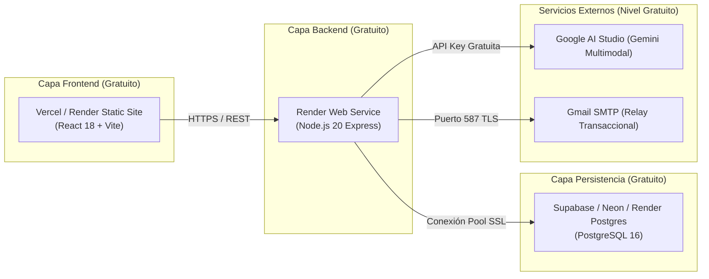

# Guía Oficial de Despliegue en la Nube Gratuita y Credenciales de Prueba
**Asignatura:** Desarrollo de Aplicaciones Empresariales  
**Programa:** Tecnología en Desarrollo de Sistemas Informáticos – Unidades Tecnológicas de Santander (UTS)  
**Docente:** Wilson Castaño Galviz  
**Fecha:** Octubre 31, 2026  
**Proyecto:** DocuMind & PQRS B2B Enterprise  
**Versión:** 3.0.0 (Tercer Corte)

---

## 1. Alcance y Cumplimiento de la Guía Académica

La guía del Tercer Corte exige de manera taxativa:
> *"El motor corre en un servidor desplegado (no solo en el computador del estudiante)... Todas las herramientas que se usen en este corte deben ser gratuitas, de código abierto o con un nivel gratuito suficiente para el proyecto... Entregable: Enlace al aplicativo desplegado y credenciales de prueba."*

Esta guía detalla los pasos para poner en marcha el sistema en plataformas **100% gratuitas**, los esquemas de base de datos a inicializar y las credenciales listas para que el docente evalúe el sistema en vivo.

---

## 2. Credenciales de Prueba para el Docente / Evaluador

El aplicativo cuenta con Control de Acceso Basado en Roles (**RBAC**) y roles diferenciados:

| Rol de Usuario | Correo Electrónico | Contraseña de Prueba | Permisos y Pantallas Disponibles |
|---|---|---|---|
| **Administrador General (TI)** | `admin@documind.com` | `Admin123*` | Control total del sistema, Dashboard de TI, métricas de hardware/logs, auditoría transaccional de IA (`pqrs_logs_ejecuciones`) y administración de repositorios. |
| **Agente Operativo (Soporte)** | `agente@documind.com` | `Agente123*` | Workspace de gestión PQRS, reasignación de tickets, actualización de estados, cálculo dinámico de SLAs y visor de comprobantes. |
| **Analista Departamental** | `diana.legal@documind.com` | `Legal123*` | Chatbot RAG Inteligente, consulta multimodal de evidencias y formularios, ingesta documental y comparación de contratos. |
| **Ciudadano / Solicitante** | *Acceso Público Anónimo* | *No requiere login* | Acceso libre a Radicación Web (`/radicar`), Digitalización con Cámara/Celular (`/vision`) y Consulta por Doble Factor (Radicado + Tracking Token). |

---

## 3. Arquitectura de Despliegue Gratuito Recomendada



---

## 4. Opción A: Despliegue 1-Click con Render (Recomendada)

Render permite desplegar el Backend, el Frontend y PostgreSQL en una sola operación mediante el archivo [`render.yaml`](../render.yaml) incluido en la raíz del repositorio.

### Paso 1: Conectar el Repositorio
1. Iniciar sesión en [Render.com](https://render.com) (cuenta gratuita con GitHub).
2. Ir a **Blueprints** -> Clic en **New Blueprint Instance**.
3. Seleccionar el repositorio: `https://github.com/JuanFe28/documind-pqrs-b2b`.
4. Render detectará automáticamente el archivo `render.yaml` y configurará:
   - Base de datos: `documind-postgres` (PostgreSQL 16).
   - Backend API: `documind-backend` (Node.js).
   - Frontend SPA: `documind-frontend` (Static Site).

### Paso 2: Configurar Secretos en el Dashboard de Render
En el servicio `documind-backend` -> pestaña **Environment**, ingresar:
- `GEMINI_API_KEY`: Tu clave gratuita obtenida en [Google AI Studio](https://aistudio.google.com/).
- `SMTP_USER`: Correo institucional o Gmail para pruebas.
- `SMTP_PASS`: Contraseña de aplicación de 16 dígitos generada en la cuenta de Google.

### Paso 3: Inicializar la Base de Datos
Una vez aprovisionado el PostgreSQL de Render:
1. Copiar la **External Database URL**.
2. Conectarse mediante cualquier cliente SQL (DBeaver, pgAdmin o terminal `psql`).
3. Ejecutar en orden los dos scripts de la carpeta `database/`:
   ```bash
   psql "<EXTERNAL_DB_URL>" -f database/init_db.sql
   psql "<EXTERNAL_DB_URL>" -f database/documind_postgres_schema.sql
   ```
4. Los scripts crearán automáticamente las tablas del sistema, incluyendo `pqrs_logs_ejecuciones` y los usuarios de semilla para las pruebas.

---

## 5. Opción B: Despliegue con Supabase (DB) + Vercel (Front) + Render (Back)

Esta alternativa distribuye la carga entre los mejores proveedores gratuitos:

### 1. Base de Datos en Supabase (Free Tier permanente)
1. Crear un proyecto nuevo en [Supabase](https://supabase.com).
2. Ir al **SQL Editor** y pegar el contenido de:
   - [`database/init_db.sql`](../database/init_db.sql)
   - [`database/documind_postgres_schema.sql`](../database/documind_postgres_schema.sql)
3. Clic en **Run**. Las 12 tablas, triggers, funciones e índices quedarán creados.
4. En **Project Settings** -> **Database**, copiar los datos de conexión: Host, Puerto 5432, Usuario `postgres` y Contraseña elegida.

### 2. Backend en Render o Railway
1. Crear un **Web Service** apuntando al subdirectorio `backend/`.
2. Asignar las variables de entorno de [`.env.production.example`](../.env.production.example):
   ```env
   NODE_ENV=production
   PORT=5000
   DB_HOST=db.xxxxxxxxxxxx.supabase.co
   DB_PORT=5432
   DB_USER=postgres
   DB_PASSWORD=tu_password_supabase
   DB_NAME=postgres
   DB_SSL=true
   JWT_SECRET=secreto_seguro_documind_uts_2026
   GEMINI_API_KEY=AIzaSy...
   ```
3. URL resultante: `https://tu-backend.onrender.com`.

### 3. Frontend en Vercel
1. Importar el repositorio en [Vercel](https://vercel.com).
2. Root Directory: `frontend`.
3. Framework Preset: `Vite`.
4. Variable de entorno:
   ```env
   VITE_API_BASE_URL=https://tu-backend.onrender.com/api
   ```
5. Clic en **Deploy**. El frontend quedará publicado con HTTPS automático.

---

## 6. Opción C: Despliegue con Docker Compose en VPS o Servidor Propio

Si el grupo dispone de un VPS gratuito (como Oracle Cloud Free Tier) o servidor universitario:

```bash
# 1. Clonar el repositorio en el servidor
git clone https://github.com/JuanFe28/documind-pqrs-b2b.git
cd actividad-pqrs-b2b

# 2. Configurar variables de producción
cp .env.production.example backend/.env

# 3. Compilar y levantar la infraestructura
docker compose -f docker-compose.prod.example.yml up -d --build

# 4. Verificar salud del servicio
curl http://localhost:5000/api/health
```

---

## 7. Checklist de Verificación Post-Despliegue

Antes de entregar los enlaces al docente:
- [ ] **Healthcheck activo:** `https://tu-backend/api/health` debe retornar `HTTP 200 { "status": "UP" }`.
- [ ] **Login con roles:** Probar login con `admin@documind.com` y verificar que el dashboard cargue métricas.
- [ ] **Radicación con Visión IA:** Probar la subida de un formulario físico desde `/vision` y confirmar que el score de confianza y los campos se extraigan correctamente.
- [ ] **Chatbot Multimodal:** Abrir `/chat`, adjuntar una imagen con el botón de cámara y comprobar que aparezca el botón de radicar en PQRS.
- [ ] **Auditoría en Base de Datos:** Comprobar que tras radicar se cree una fila en `pqrs_logs_ejecuciones`.
- [ ] **HTTPS obligatorio:** Confirmar que el navegador muestre el candado de seguridad sin alertas de certificados no válidos.
