# Guión de Video de Demostración en Vivo – Tercer Corte (8 Minutos Máximo)
**Asignatura:** Desarrollo de Aplicaciones Empresariales  
**Programa:** Tecnología en Desarrollo de Sistemas Informáticos – Unidades Tecnológicas de Santander (UTS)  
**Docente:** Wilson Castaño Galviz  
**Fecha:** Octubre 31, 2026  
**Proyecto:** DocuMind & PQRS B2B Enterprise  
**Duración Total Estimada:** **7 minutos con 45 segundos** (Límite máximo permitido: 8 minutos).  

---

## 🎯 Objetivo del Video
Demostrar de forma fluida, técnica y sin cortes la operatividad real del sistema desplegado, evidenciando:
1. El **desacoplamiento total de n8n** mediante el motor propio en Node.js/Express (Ruta A).
2. El **módulo de visión por computador e IA multimodal** procesando fotografías reales tomadas con celular.
3. El funcionamiento del mecanismo **Human-in-the-Loop** (`score < 0.85`) y el **Plan B de contingencia local** sin errores HTTP 500.
4. La **integración del Chatbot** como canal de visión y disparo automático a radicación PQRS.
5. La **auditoría transaccional** (`pqrs_logs_ejecuciones`), el cumplimiento de la **Ley 1581 de 2012** y las **pruebas automatizadas**.

---

## ⏱️ Cronograma Minuto a Minuto del Video

```mermaid
gantt
    title Estructura del Video de Demostración (8 Minutos)
    dateFormat X
    axisFormat %s seg
    section Presentación y Ruta A
    01. Intro y Reemplazo de n8n (Ruta A) : 0, 75
    02. SLAs Dinámicos e Idempotencia : 75, 165
    section Visión Multimodal
    03. Módulo de Visión con Fotos Celular : 165, 270
    04. Human-in-the-Loop y Plan B Local : 270, 345
    section Integración y Cierre
    05. Chatbot con Visión y Disparo PQRS : 345, 415
    06. Seguridad Ley 1581, Pruebas y Cierre : 415, 465
```

---

## 🎬 Recorrido Detallado Escena por Escena

### Escena 1: Presentación y Demostración de la Ruta A (00:00 – 01:15)
- **Pantalla a mostrar:** Pestaña del navegador abierta en el portal de radicación (`http://localhost:5173/radicar` o aplicativo desplegado) y una ventana de terminal con `backend` corriendo sin ningún contenedor de n8n activo.
- **Acción:** Radicar una solicitud estándar desde el formulario.
- **Qué decir al micrófono (Voz en off):**
  > *"Cordial saludo, profesor Wilson y compañeros. En este video presentamos la entrega final del Tercer Corte de Desarrollo de Aplicaciones Empresariales.*  
  > *El primer gran objetivo fue desacoplarnos definitivamente de n8n en la nube sin incurrir en costos. Optamos por la **Ruta A: automatización propia en código Node.js/Express**.*  
  > *Observen que el contenedor de n8n está completamente apagado y deshabilitado. Vamos a radicar un caso directamente desde nuestro portal web empresarial."*
- **Acción en pantalla:** Diligenciar nombre `Carlos Gómez`, correo `carlos.gomez@empresa.com`, tipo `Reclamo`, prioridad `Alta`. Clic en **"Radicar Solicitud"**.
- **Resultado visible:** Se genera de inmediato el radicado `PQRS-2026-XXXXXX` con su `tracking_token` UUIDv4 y plazo SLA de 4 horas corridas.
- **Qué decir:**
  > *"La solicitud fue atendida nativamente por nuestro servicio `automation.service.js`. La respuesta es inmediata, con cálculo dinámico de SLAs y desacoplamiento SMTP."*

---

### Escena 2: Auditoría Transaccional, SLAs e Idempotencia (01:15 – 02:45)
- **Pantalla a mostrar:** Cambiar a la vista del Gestor de Base de Datos (DBeaver/pgAdmin o endpoint `/api/pqrs/logs`) mostrando la tabla `pqrs_logs_ejecuciones`.
- **Qué decir:**
  > *"Como exige la guía, cada flujo cuenta con manejo de errores, reintentos y auditoría estricta. Fíjense en la tabla `pqrs_logs_ejecuciones`: aquí queda grabado el timestamp exacto, el actor, el flujo ejecutado `F01_RADICAR_PQRS`, la duración en milisegundos y el estado `EXITOSO` con el payload completo."*
- **Demostración de Idempotencia:**
  - Volver al navegador o enviar la misma petición con el mismo `request_id`.
  - **Qué decir:**
    > *"El sistema implementa idempotencia estricta por `request_id`. Si por inestabilidad de red el cliente reintenta la misma petición, el servidor detecta el identificador existente y retorna `HTTP 200` con el mismo número de radicado sin duplicar registros en la base de datos."*
- **Demostración de Tracking Público:**
  - Ir a la pestaña de seguimiento e ingresar el radicado y el token privado.
  - Mostrar la línea de tiempo del caso con cumplimiento de SLA y datos personales protegidos.

---

### Escena 3: Módulo de Visión por Computador con Fotos Reales de Celular (02:45 – 04:30)
- **Pantalla a mostrar:** Navegar en el menú lateral a **"Digitalización Visión IA"** (`/vision`).
- **Qué decir:**
  > *"Pasamos al Componente 2: IA Multimodal de Visión aplicada al proceso de negocio. Elegimos el caso de lectura y digitalización de formularios físicos PQRS diligenciados en papel y fotografías de novedades tomadas con celulares en campo."*
- **Acción:**
  - Clic en el área de carga o arrastrar una fotografía real de la carpeta `tests/fixtures/vision/` (por ejemplo, `01_formulario_facturacion_luz_natural.jpg`).
  - Mostrar la vista previa de la fotografía real tomada con celular con notas manuscritas.
  - Clic en el botón **"Analizar con Visión IA"**.
- **Resultado visible:**
  - Aparece la barra de progreso y en menos de 2 segundos se despliega el resultado.
  - La tarjeta de diagnóstico muestra:
    - **Modelo:** Google Gemini Vision (Multimodal).
    - **Score de Confianza:** `92%` (Badge verde).
    - **Campos estructurados en JSON:** Nombre, Correo, Teléfono, Tipo de PQRS (`Facturación`), Prioridad (`Alta`), Asunto y Descripción completa extraída del texto del formulario físico.
- **Qué decir:**
  > *"El módulo visual interpretó el formulario, extrajo las entidades estructuradas y calculó una certeza del 92%. Al superar el umbral del 85%, el sistema permite la radicación automática con un solo clic."*
- **Acción:** Clic en **"Radicar Solicitud Oficial"** -> Aparece la alerta verde con el nuevo radicado oficial generado directamente a partir de la foto del papel.

---

### Escena 4: Human-in-the-Loop y Plan B de Resiliencia Local (04:30 – 05:45)
- **Pantalla a mostrar:** Misma pantalla `/vision`.
- **Demostración 1: Human-in-the-Loop (`score_confianza < 0.85`):**
  - Cargar una imagen con condiciones difíciles (ejemplo: `03_formulario_peticion_luz_baja.jpg` o `17_formulario_letra_manuscrita_dificil.jpg`).
  - Clic en **"Analizar con Visión IA"**.
  - **Resultado:** El badge cambia a amarillo: `⚠️ Requiere Revisión (79%)`.
  - Se despliega la tarjeta de advertencia indicando qué campos presentan dudas.
  - Los campos del formulario aparecen editables para que el analista ajuste el nombre o correo antes de guardar.
  - **Qué decir:**
    > *"Aquí observamos el principio de Human-in-the-Loop exigido por el docente. Cuando la confianza cae por debajo del 85% o la caligrafía es dudosa, el sistema nunca guarda a ciegas: activa la advertencia y solicita validación humana."*

- **Demostración 2: Plan B de Contingencia (Agotamiento de Cuota o Fallo de Red):**
  - Mostrar en terminal o en los logs de auditoría cómo se comporta el sistema si no hay API key o si se alcanza el límite de cuota (HTTP 429).
  - Cargar un formulario de prueba.
  - **Resultado:** En los logs de Express se imprime: `[Vision Service] Fallo en modelo primario de visión -> Activando Plan B Heurístico Local`.
  - El frontend responde en `200 OK` (nunca falla con 500) usando el motor heurístico local en memoria, marcando `requiere_revision_humana = true`.
  - **Qué decir:**
    > *"Cumplimos con el requisito transversal de control de costos: si el modelo gratuito agota su cuota o se cae internet, nuestro **Plan B Heurístico Local** asume el control en memoria, extrayendo las entidades con expresiones regulares y permitiendo que la operación continúe sin interrupciones."*

---

### Escena 5: Integración del Chatbot con el Módulo de Visión (05:45 – 06:55)
- **Pantalla a mostrar:** Navegar en el menú a **"Chat Conversacional RAG"** (`/chat`).
- **Qué decir:**
  > *"La guía especifica que el chatbot debe ser uno de los canales para usar el nuevo módulo de visión y disparar el proceso de negocio. Veamos cómo interactúa un agente desde el chat."*
- **Acción:**
  - En la barra inferior del chat, hacer clic en el **botón de cámara (<Camera />)**.
  - Seleccionar una fotografía de evidencia (ejemplo: `04_evidencia_novedad_terminal_averiado.jpg`).
  - Aparece el chip con la miniatura de la imagen adjunta.
  - Escribir en el prompt: *"Analiza esta novedad de hardware y dime si procede un cambio urgente"*.
  - Presionar Enter.
- **Resultado visible:**
  - En el chat aparece el mensaje del usuario con la miniatura de la foto.
  - DocuMind responde con análisis multimodal, tabla de campos detectados y una tarjeta interactiva con el botón **"⚡ Radicar en PQRS"**.
  - El agente hace clic en **"⚡ Radicar en PQRS"** directamente dentro de la burbuja del chat.
  - El sistema radica el caso en vivo y confirma en verde: `¡Solicitud radicada con éxito! Radicado: PQRS-2026-000045 | SLA: 2 horas`.
- **Qué decir:**
  > *"Como pueden observar, el chatbot no solo conversa: ahora 've', interpreta evidencias fotográficas y dispara la automatización nativa de PQRS sin salir de la conversación."*

---

### Escena 6: Seguridad (Ley 1581 / RBAC), Pruebas Automatizadas y Cierre (06:55 – 07:45)
- **Pantalla a mostrar:** Terminal dividida con ejecución de pruebas y la página del repositorio en GitHub.
- **Acción:**
  - Ejecutar en terminal: `cd backend && npm test __tests__/automation_and_vision.test.js`.
  - Mostrar los **15 tests aprobados en verde** (SLAs, idempotencia, visión multimodal y Plan B).
  - Ejecutar en terminal: `node tests/evaluar_vision_20_imagenes.js`.
  - Mostrar el benchmark sobre los **20 casos reales fotografiados con celular**:
    - Precisión Global: `78.33%`.
    - Confianza Promedio: `88.00%`.
    - Tiempo Promedio: `1.6 s`.
- **Qué decir:**
  > *"Finalmente, el sistema cumple con la **Ley 1581 de 2012**: protección de datos personales con autorización previa, tokens UUID no predecibles para evitar enumeración y control de acceso RBAC.*  
  > *Todo nuestro código está versionado en Git, respaldado con 98 pruebas automatizadas y documentado en nuestro documento técnico de 10 páginas.*  
  > *Agradecemos su atención y quedamos listos para las preguntas de la sustentación."*
- **Fin del video:** (07:45 - 08:00) Pantalla final con nombres de los integrantes y enlace al repositorio.

---

## 📋 Checklist Rápido de Grabación (Para los Integrantes)

Antes de presionar el botón de **Grabar**:
- [ ] Base de datos PostgreSQL levantada con la tabla `pqrs_logs_ejecuciones` creada.
- [ ] Servidor backend corriendo en puerto 5000 (`npm start` o `node server.js`).
- [ ] Frontend corriendo en puerto 5173 (`npm run dev`).
- [ ] Carpeta de imágenes de prueba `tests/fixtures/vision/` abierta y a la mano para arrastrar archivos.
- [ ] Pestañas de navegador ordenadas:
  1. `http://localhost:5173/radicar` (Portal de Radicación)
  2. `http://localhost:5173/vision` (Digitalización Visión IA)
  3. `http://localhost:5173/chat` (Chatbot Multimodal)
- [ ] Terminal abierta y limpia lista para ejecutar `node tests/evaluar_vision_20_imagenes.js`.
- [ ] Cronómetro en pantalla o en el teléfono para no superar los 8:00 minutos.
