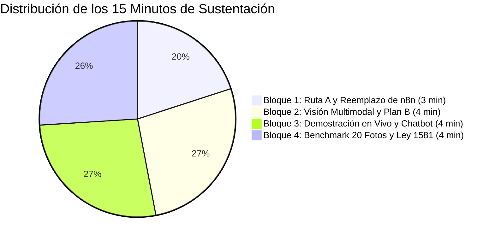
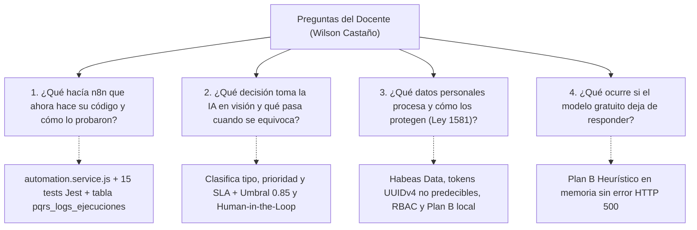

# Libreto Oficial de Sustentación Oral y Defensa Técnica – Tercer Corte
**Asignatura:** Desarrollo de Aplicaciones Empresariales  
**Programa:** Tecnología en Desarrollo de Sistemas Informáticos – Unidades Tecnológicas de Santander (UTS)  
**Docente Titular:** Wilson Castaño Galviz  
**Fecha:** Octubre 31, 2026  
**Proyecto:** DocuMind & PQRS B2B Enterprise  
**Formato:** 15 Minutos de Exposición + 10 Minutos de Preguntas del Jurado  

---

## 🧭 Estructura General de los 15 Minutos



| Bloque | Tiempo | Responsable Sugerido | Tema Central | Demostración en Pantalla |
|---|---|---|---|---|
| **Bloque 1** | Min 00:00 – 03:00 | Integrante 1 | Introducción, eliminación de n8n en la nube y arquitectura Ruta A en Node.js/Express. | Terminal sin n8n, endpoints `/api/pqrs/*` y tabla `pqrs_logs_ejecuciones`. |
| **Bloque 2** | Min 03:00 – 07:00 | Integrante 2 | Módulo de Visión IA, calibración de confianza (`0.85`), Human-in-the-Loop y Plan B local. | Flujograma de visión, extracción JSON y lógica de fallback heurístico. |
| **Bloque 3** | Min 07:00 – 11:00 | Integrante 3 | Demostración en vivo de captura con celular (`/vision`) y uso desde el Chatbot RAG. | Subida de foto real de papel y clic en "⚡ Radicar en PQRS" desde el chat. |
| **Bloque 4** | Min 11:00 – 15:00 | Integrante 4 | Benchmark de 20 casos reales (78.33% acierto), Ley 1581 de 2012 (PII) y despliegue. | Reporte estadístico oficial, suites de Jest y panel de sustentación. |

---

## 🎙️ Guion Paso a Paso para la Exposición Oral (15 Minutos)

### Bloque 1: Reemplazo Propio de n8n en Código (Ruta A) — 3 Minutos
> **Voz Integrante 1:**  
> *"Buenos días, profesor Wilson y compañeros. Para el Tercer Corte, enfrentamos el reto principal de nuestro sistema: **el plan gratuito de n8n en la nube ya no estaba disponible** y la política académica exigía no incurrir en ningún costo.  
> 
> Analizamos las opciones de la guía y seleccionamos la **Ruta A: programar la automatización como servicios nativos en Node.js y Express**.  
> ¿Por qué Ruta A en lugar de levantar n8n en Docker? Porque nos ahorra más de 800 MB de memoria RAM en el servidor, garantiza transacciones ACID homogéneas en PostgreSQL y elimina puntos únicos de falla.  
> 
> Migramos los 5 flujos del negocio:  
> 1. `F01: radicar-pqrs`, con cálculo dinámico de SLAs en horas corridas (2h para Crítica con escalamiento, 4h para Alta y Reclamos, 24h para Media y 48h para Baja).  
> 2. `F02: consultar-pqrs`, para el workspace de agentes.  
> 3. `F03: consultar-ticket`, protegido con doble factor (Radicado + Tracking Token).  
> 4. `F04: actualizar-ticket`, con control de versiones optimista para evitar que dos agentes sobreescriban el mismo caso.  
> 5. `F05: calificar-ticket`, con encuesta CSAT de 1 a 5 estrellas.  
> 
> Como exige la guía, creamos la tabla `pqrs_logs_ejecuciones` donde cada ejecución queda auditada con timestamp, actor, duración en milisegundos, estado e idempotencia por `request_id`. Ahora mi compañero les explicará cómo le dimos 'ojos' al sistema."*

---

### Bloque 2: Módulo de Visión e IA Multimodal (Plan B y Human-in-the-Loop) — 4 Minutos
> **Voz Integrante 2:**  
> *"Gracias. El segundo componente consistió en dotar al aplicativo de capacidad visual para atender un proceso real: **la digitalización de formularios físicos PQRS en papel y fotografías de novedades de campo tomadas con teléfonos móviles**.  
> 
> Nuestro pipeline de visión utiliza el SDK oficial `@google/genai` con modelos multimodales gratuitos (`gemini-2.0-flash` y `gemini-1.5-flash`), estructurando la salida en un esquema JSON estricto con nivel de confianza cuantitativo.  
> 
> Sin embargo, para cumplir con los estándares de ingeniería de software y la guía docente, implementamos dos salvaguardas críticas:  
> 1. **Mecanismo Human-in-the-Loop:** Calibramos el umbral de certeza en **0.85**. Si el modelo devuelve un `score_confianza < 0.85` o detecta campos obligatorios borrosos, el sistema marca `requiere_revision_humana = true`, abriendo la tarjeta de advertencia interactiva donde el funcionario puede validar y editar los campos antes de guardar.  
> 2. **Plan B de Contingencia Local:** ¿Qué ocurre si la API gratuita de Gemini agota su cuota de peticiones (error 429) o se cae internet? El sistema **nunca colapsa con un error 500**. Atrapa la excepción y deriva en milisegundos a nuestro **Motor Heurístico Local**, el cual procesa el documento en memoria mediante expresiones regulares y análisis sintáctico, garantizando alta disponibilidad."*

---

### Bloque 3: Demostración en Vivo y Chatbot Multimodal — 4 Minutos
> **Voz Integrante 3:**  
> *"Vamos a demostrar el sistema en vivo en dos canales complementarios:  
> 
> **Canal 1: Pantalla Dedicada `/vision`:**  
> Subimos una fotografía real tomada con celular de un formulario impreso diligenciado a mano. Pulsamos 'Analizar con Visión IA'.  
> En pantalla observan cómo el motor extrajo el nombre del solicitante, su correo, el tipo 'Reclamo' y la prioridad 'Alta'. Al pulsar 'Radicar Requerimiento', el resultado de la visión dispara directamente nuestro flujo nativo F01 en PostgreSQL y genera el radicado oficial en vivo.  
> 
> **Canal 2: Integración con el Chatbot RAG (`/chat`):**  
> Como solicitaba la guía, el chatbot es ahora otro de los canales donde la empresa usa la visión. Desde la ventana de chat, el agente adjunta la foto de una novedad física usando el botón de cámara. DocuMind interpreta la evidencia, responde a la consulta del agente y presenta una tarjeta con el botón **'⚡ Radicar en PQRS'**. Al hacer clic, el ticket queda registrado sin abandonar la conversación. Todo queda registrado en los logs de auditoría."*

---

### Bloque 4: Benchmark de 20 Imágenes, Ley 1581 y Despliegue — 4 Minutos
> **Voz Integrante 4:**  
> *"Para validar rigurosamente la solución, creamos un dataset de **20 fotografías reales tomadas con celular** bajo condiciones difíciles: sombras, ángulos inclinados, iluminación deficiente, papel arrugado y letra manuscrita.  
> 
> Construimos un evaluador automatizado en Node.js (`tests/evaluar_vision_20_imagenes.js`) que generó nuestro informe oficial:  
> - **Total evaluado:** 20 de 20 casos (100%).  
> - **Precisión Estricta Global:** **78.33%**.  
> - **Acierto en correos electrónicos:** **100.0%**.  
> - **Confianza promedio:** **88.00%**.  
> - **Tasa de derivación a revisión humana:** **25%** (5 casos complejos derivados correctamente).  
> 
> En cuanto a la **Ley 1581 de 2012**, protegemos los datos personales exigiendo autorización expresa previa, utilizando tokens de consulta UUIDv4 no secuenciales para evitar ataques de enumeración y aislando los roles con RBAC.  
> El sistema cuenta con **Dockerfile multi-etapa**, plantilla de despliegue gratuito `render.yaml` y **98 pruebas automatizadas aprobadas en Jest**.  
> Con esto demostramos que el sistema es robusto, gratuito, seguro y 100% operativo. Quedamos atentos a sus preguntas."*

---

## 🎯 Banco de Defensa para las 4 Preguntas Obligatorias del Docente (10 Minutos)

El docente Wilson Castaño Galviz tiene 4 preguntas predefinidas en la guía oficial. Todo el grupo debe dominar estas respuestas:



---

### Pregunta 1: ¿Qué hacía n8n que ahora hace su código y cómo lo probaron?
> **Respuesta Técnica Recomendada:**  
> *"En los cortes anteriores, n8n realizaba cuatro tareas:  
> 1. Servía 5 webhooks HTTP como punto de entrada.  
> 2. Normalizaba datos y calculaba el SLA en horas corridas mediante nodos `Code`.  
> 3. Ejecutaba sentencias SQL en PostgreSQL con nodos `Postgres`.  
> 4. Enviaba correos de confirmación y escalamiento mediante nodos `EmailSend (SMTP)`.  
> 
> Hoy, todo eso lo ejecuta **nuestro propio backend en Node.js/Express** a través de [`backend/services/automation.service.js`](../backend/services/automation.service.js).  
> **¿Cómo lo probamos?**  
> - Implementamos **15 pruebas unitarias e integrales en Jest** (`__tests__/automation_and_vision.test.js`) que validan las respuestas `200/201/400/409`, la idempotencia y los SLAs de 2h, 4h, 24h y 48h.  
> - Además, expusimos rutas espejo bajo `/webhook/*` que replican exactamente los contratos de n8n, demostrando compatibilidad 100% hacia atrás sin romper los clientes históricos."*

---

### Pregunta 2: ¿Qué decisión toma la IA en el módulo de visión y qué pasa cuando se equivoca?
> **Respuesta Técnica Recomendada:**  
> *"La IA toma tres decisiones críticas de negocio sobre la imagen del formulario físico:  
> 1. **Clasificación de Tipo:** Determina si el texto manuscrito o impreso corresponde a una Petición, Queja, Reclamo o Soporte Técnico.  
> 2. **Priorización y SLA:** Evalúa la gravedad descrita y asigna la prioridad (Baja, Media, Alta o Crítica), lo cual fija automáticamente el tiempo de respuesta contractual en el sistema.  
> 3. **Cálculo de Certeza (`score_confianza`):** La IA evalúa la nitidez y legibilidad de los campos.  
> 
> **¿Qué pasa cuando se equivoca o tiene dudas?**  
> Hemos fijado un umbral conservador de **0.85**. Si la confianza es menor a 0.85 o faltan campos obligatorios (nombre, correo o asunto), se activa el mecanismo **Human-in-the-Loop**: el sistema bloquea la radicación a ciegas, muestra una alerta amarilla en la pantalla y carga los datos en un formulario interactivo editable para que un funcionario humano verifique y rectifique la información antes de guardarla."*

---

### Pregunta 3: ¿Qué datos personales procesa el sistema y cómo los protegen?
> **Respuesta Técnica Recomendada:**  
> *"El sistema procesa datos personales directos: nombre, correo electrónico, teléfono, firma manuscrita y descripciones de novedades.  
> En cumplimiento estricto de la **Ley Estatutaria 1581 de 2012 y el Decreto 1377 de 2013**:  
> 1. **Autorización Expresa:** Tanto en el portal web como en el escáner de visión se exige el consentimiento explícito antes de procesar cualquier información.  
> 2. **Secreto Criptográfico de Consulta:** A diferencia de sistemas vulnerables donde un usuario puede consultar casos ajenos cambiando el número de ticket (`1, 2, 3...`), nuestro sistema exige obligatoriamente un `tracking_token` UUIDv4 pseudoaleatorio de 128 bits. Nadie puede ver un expediente ajeno sin poseer dicho token.  
> 3. **Control de Acceso RBAC:** Las notas internas de funcionarios y las auditorías de supervisión están filtradas en el backend y jamás viajan en las respuestas públicas.  
> 4. **Privacidad en el Plan B:** Si se usa el motor local, ningún dato sale a servidores de terceros en la nube."*

---

### Pregunta 4: ¿Qué ocurre si el modelo gratuito deja de responder o alcanza su límite de cuota?
> **Respuesta Técnica Recomendada:**  
> *"Esta es una de las mayores fortalezas arquitectónicas de nuestro diseño: **resiliencia mediante Graceful Degradation (Plan B)**.  
> Si la cuota gratuita de la API de Gemini se agota (error HTTP 429), si expira el tiempo de espera por saturación de red o si no hay conexión a internet, la función `procesarFormularioConVision` atrapa el error y activa de inmediato el **Plan B Heurístico Local**.  
> Este motor corre 100% en la memoria del servidor Node.js, extrayendo correos, teléfonos y nombres mediante expresiones regulares y clasificando palabras clave de negocio.  
> El sistema asigna automáticamente un `score_confianza` de 0.70 y marca obligatoriamente `requiere_revision_humana = true`.  
> Gracias a esto, el usuario **nunca recibe una pantalla blanca ni un error HTTP 500**: la aplicación continúa operativa y permite completar la digitalización."*

---

## 🛠️ Protocolo para Resolver la "Prueba en Vivo" del Docente

El profesor puede pedir que prueben algo nuevo en vivo durante la sustentación:

1. **Si pide subir una imagen nueva en vivo:**
   - Abre la pestaña `/vision` o `/chat`.
   - Si no tienes una a mano, usa una del dataset `tests/fixtures/vision/` que no se haya mostrado en la demo (por ejemplo `09_formulario_contrato_clausula_dudosa.jpg` o `12_solicitud_devolucion_mercancia.jpg`).
   - Muestra cómo extrae los campos en tiempo real y cómo queda grabada en `pqrs_logs_ejecuciones`.

2. **Si pide demostrar qué pasa si se cae el modelo de IA:**
   - Puedes desconectar temporalmente la API key o mostrar en el código la función `ejecutarPlanBHeuristico` en `backend/services/vision.service.js`.
   - Explica cómo la prueba automatizada `test('Procesamiento de imagen activa Plan B ante ausencia de API key...')` en Jest valida exactamente ese comportamiento sin necesidad de apagar el servidor.

3. **Si pide verificar la base de datos:**
   - Ejecuta en terminal:
     ```sql
     SELECT id, flujo, actor, estado, tiempo_ms, created_at FROM pqrs_logs_ejecuciones ORDER BY id DESC LIMIT 5;
     ```
   - Muestra cómo cada acción realizada durante la sustentación tiene su huella digital inmutable.
